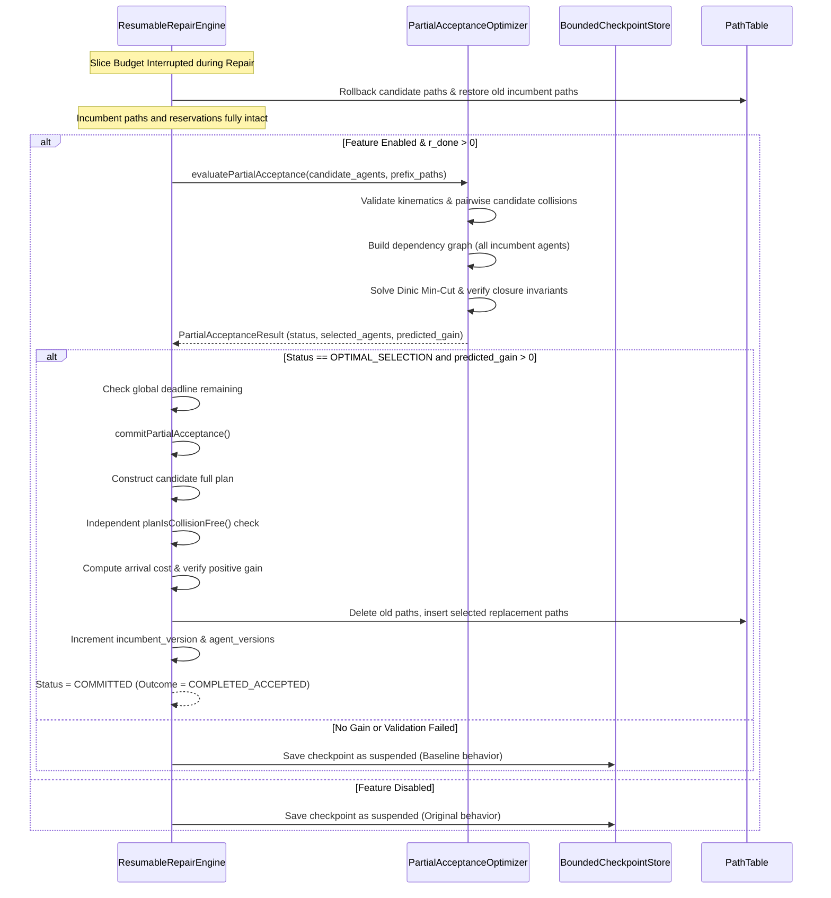

> Historical document retained for context. Current implementation, deadline-quality
> results and corrected claims are in [the corrected report](selective_recovery_technical_report.md).
> Historical saved-plan validation does not establish current publication-time behavior.

# RouteBudget Lab: Maximum-Gain Partial Acceptance Design Document

**Document Version:** 1.1.0  
**Date:** 31 October 2026  
**Proposed Algorithmic Extension:** Maximum-Gain Partial Acceptance of Interrupted MAPF-LNS Repairs Under Planning Deadlines  
**Author:** Antigravity AI (Pair Programming with P. G. Disas Sethnada)  
**Status:** Implemented, Audited (17/17 Unit Tests Passing in Release & ASan/UBSan), Verified Against Truly Independent $2^r$ Path-Mixture Oracle (43,166 Natural Snapshots + 126 Synthetic/Randomized Cases, 0 Mismatches), and Evaluated in 192-Run Sequential Live Pilot.

---

## 1. Problem Statement & Motivation

In anytime Multi-Agent Path Finding via Large Neighborhood Search (MAPF-LNS, Li et al., 2021), a subset of agents (the destroy neighborhood $\mathcal{N} \subset A$) have their paths removed from the reservation table and replanned sequentially via prioritized Space-Time A*. Under strict real-time or cooperative execution deadlines, low-level single-agent searches or slice budgets are frequently interrupted before all $|\mathcal{N}|$ agents can be routed.

Historically, MAPF-LNS either:
1. **Discards the entire repair attempt:** Throwing away all completed replacement paths $Q_i$ for $i \in R \subset \mathcal{N}$.
2. **Saves completed prefixes into a checkpoint:** Attempting to resume the remaining suffix in a subsequent time slice (RouteBudget Lab Phase 3-4). However, resumption can be blocked if external trajectory updates modify the environment or if subsequent slices do not prioritize the suspended neighborhood.

The Maximum-Gain Partial Acceptance extension addresses a fundamental question:
> *Which completed replacement paths from an interrupted repair can be committed immediately into the incumbent solution, alongside the existing paths of all other agents, to achieve the largest safe immediate reduction in Sum of Costs?*

Because replacement paths were planned sequentially in the absence of the neighborhood's old paths, an individual replacement path $Q_i$ may conflict with the old path $P_j$ of another agent $j$ whose replacement is either incomplete or missing. Therefore, path replacements cannot be accepted independently. They form **dependency implications** that must be resolved jointly.

---

## 2. Mathematical Formulation

Let:
- $A = \{0, 1, \dots, m-1\}$ be the set of all agents in the MAPF instance.
- $P = \{P_i : i \in A\}$ be the current complete, valid, collision-free incumbent solution.
- $\mathcal{N} \subseteq A$ be the destroyed neighborhood selected for repair.
- $R \subseteq \mathcal{N}$ be the set of agents that successfully completed start-to-goal replacement paths before interruption ($r = |R| = r_{\text{done}}$).
- $Q_i$ be the completed replacement path for agent $i \in R$.
- $c(\text{path})$ be the arrival cost of the path at its goal location:
  $$c(\text{path}) = \max \{ t + 1 : \text{path}[t] \ne \text{goal} \} \quad (\text{or } 0 \text{ if path never leaves goal})$$
  *(Terminal padding waits at the goal are not counted as extra arrival cost).*
- $x_i \in \{0, 1\}$ be the binary decision variable:
  - $x_i = 1$: Install replacement path $Q_i$.
  - $x_i = 0$: Retain incumbent path $P_i$.

### 2.1 Replacement Weights
For each candidate $i \in R$, the net Sum-of-Costs reduction (weight) is:
$$w_i = c(P_i) - c(Q_i)$$
Weights $w_i$ may be positive ($c(Q_i) < c(P_i)$), zero ($c(Q_i) = c(P_i)$), or negative ($c(Q_i) > c(P_i)$). Negative-weight and zero-weight nodes are explicitly preserved in the formulation because installing a slightly longer replacement path $Q_j$ may resolve a conflict dependency that unblocks a substantially larger positive gain $w_i > 0$ such that $w_i + w_j > 0$.

### 2.2 Conflict Dependencies & Forbidden Constraints
For every candidate $i \in R$ and every incumbent agent $j \in A \setminus \{i\}$:
1. **No Conflict:** If $Q_i$ does not conflict with $P_j$, no constraint is generated.
2. **Internal Conflict ($j \in R$):** If $Q_i$ conflicts with $P_j$ and replacement path $Q_j$ exists, selecting $Q_i$ requires replacing $P_j$ with $Q_j$. This generates a directed dependency arc:
   $$i \to j \iff x_i \le x_j$$
3. **External Conflict ($j \notin R$):** If $Q_i$ conflicts with $P_j$ and agent $j$ has no replacement available in $R$, $P_j$ cannot be removed. Thus $Q_i$ cannot be installed:
   $$x_i = 0 \quad (i \text{ is forbidden})$$

### 2.3 Optimization Problem
$$\max_{x \in \{0, 1\}^r} \sum_{i \in R} w_i x_i$$
$$\text{subject to } \begin{cases}
x_i \le x_j & \forall (i \to j) \in E_{\text{dep}} \\
x_i = 0 & \forall i \in V_{\text{forbidden}}
\end{cases}$$

The empty subset ($x_i = 0$ for all $i \in R$) is trivially feasible with objective value 0. The transaction commits if and only if the optimal objective is **strictly positive** ($\sum w_i x_i > 0$) and full independent validation passes.

---

## 3. Mandatory Assumptions

1. **Incumbent Solution Validity:** The incumbent solution $P = \{P_i : i \in A\}$ is complete, collision-free, and internally valid.
2. **Kinematic Validity:** Each candidate $Q_i$ begins at the agent's unique start, terminates at the agent's unique goal, and obeys grid connectivity (no diagonal moves, no obstacle traversal).
3. **Candidate Pairwise Collision-Freedom:** All replacement paths in $\{Q_i : i \in R\}$ are pairwise collision-free among themselves. In prioritized MAPF-LNS, this holds because each agent $i \in R$ was routed against non-neighborhood agents and previously routed replacement paths in $R$.
4. **Unique Replacement:** There is at most one candidate replacement $Q_i$ per agent $i \in R$.
5. **Static Consistency:** The grid map, start/goal locations, and temporal origin $t=0$ remain consistent throughout planning.
6. **Comprehensive Conflict Detection:** Conflict checking covers vertex collisions, edge swaps, and persistent goal occupancy for all timesteps $t \in [0, \max(|Q_i|, |P_j|)]$.
7. **Transactional Version Isolation:** The incumbent solution remains unmutated while dependencies are constructed, the cut is computed, and the candidate full solution is verified.

---

## 4. Theoretical Equivalence to Valid Path Mixtures

### Proposition:
*Under Assumptions 1–7, a binary vector $x \in \{0, 1\}^r$ corresponds to a collision-free mixed solution $\{P_k : k \notin R\} \cup \{x_i Q_i + (1-x_i) P_i : i \in R\}$ if and only if $x$ satisfies the closure dependencies ($x_i \le x_j$ for all $i \to j$) and avoids forbidden nodes ($x_i = 0$ for all $i \in V_{\text{forbidden}}$).*

### Proof:
1. **Sufficiency ($\Rightarrow$ Feasible Cut Yields Valid Solution):**
   Suppose $x$ is closed with respect to $E_{\text{dep}}$ and avoids $V_{\text{forbidden}}$. Let $S = \{i \in R : x_i = 1\}$.
   Consider any pair of agents $(a, b)$ with active paths $X_a, X_b$:
   - *Case 1 ($a, b \notin S$):* Both agents use incumbent paths $P_a, P_b$. By Assumption 1, $P$ is collision-free, so $P_a$ and $P_b$ do not collide.
   - *Case 2 ($a, b \in S$):* Both agents use replacement paths $Q_a, Q_b$. By Assumption 3, all candidates in $R$ are pairwise collision-free, so $Q_a$ and $Q_b$ do not collide.
   - *Case 3 ($a \in S, b \notin S$):* Agent $a$ uses $Q_a$ and agent $b$ uses $P_b$.
     - If $b \in R$, since $a \in S$ ($x_a = 1$) and $b \notin S$ ($x_b = 0$), closure requires that there is no dependency $a \to b$. Hence $Q_a$ does not collide with $P_b$.
     - If $b \notin R$, since $a \in S$, $a$ cannot be forbidden. By construction of $V_{\text{forbidden}}$, $Q_a$ does not collide with $P_b$.
   In all cases, no collision can occur between any pair of agents. Hence the mixture is collision-free.

2. **Necessity ($\Leftarrow$ Valid Solution Must Satisfy Constraints):**
   Suppose the mixture is collision-free.
   - If there exists $(i \to j) \in E_{\text{dep}}$ such that $x_i = 1$ and $x_j = 0$, then agent $i$ uses $Q_i$ and agent $j$ uses $P_j$. But the arc $i \to j$ was added precisely because $Q_i$ collides with $P_j$, creating a collision. Thus $x_i \le x_j$ must hold.
   - If there exists $i \in V_{\text{forbidden}}$ such that $x_i = 1$, then by definition $Q_i$ collides with $P_k$ for some agent $k \notin R$. Since $k \notin R$, agent $k$ must use $P_k$, producing a collision. Thus $x_i = 0$ must hold.
   Therefore, every valid mixture must satisfy the closure and forbidden constraints. $\blacksquare$

---

## 5. Maximum-Weight Closure to Minimum-Cut Reduction

The problem is reduced to finding a maximum-weight closure in a directed graph, solved via minimum $(s, t)$-cut (Picard, 1976; Hochbaum, 2001).

### Network Construction:
1. Nodes: Source $s$, Sink $t$, and candidate nodes $V = \{0, 1, \dots, r-1\}$.
2. Safe Integer Capacity $M$:
   $$M = 1 + \sum_{i \in R} |w_i|$$
   Computed using checked 64-bit integer arithmetic. Since $M > \sum_{w_i > 0} w_i = W^+$, cutting any edge of capacity $M$ has higher cost than cutting all positive source edges ($W^+$). Thus, an $M$-capacity edge is never cut in an optimal cut unless the closure is empty.
3. Edge Capacities:
   - For each candidate $u \in V$:
     - If $w_u > 0$: Add directed edge $(s \to u)$ with capacity $w_u$.
     - If $w_u < 0$: Add directed edge $(u \to t)$ with capacity $-w_u$.
     - If $u \in V_{\text{forbidden}}$: Add directed edge $(u \to t)$ with capacity $M$ (or add $M$ to existing capacity).
   - For each dependency $(u \to v) \in E_{\text{dep}}$:
     - Add directed edge $(u \to v)$ with capacity $M$.

### Residual Cut Extraction & Interruption Safety:
After computing maximum flow via Dinic's Algorithm ($O(V^2 E)$) with checked 64-bit integer arithmetic (`checkedAdd`, `checkedSub`) and duplicate-edge capacity accumulation:
- If the global deadline expires during `bfs()` or `dfs()`, the flow solver aborts immediately and returns `BUDGET_SKIPPED` without extracting an uncertified residual cut.
- When Dinic completes, the set $S$ of candidates reachable from $s$ via edges with positive residual capacity forms the maximum-weight closure.
- Closure validity ($u \in S \implies \neg\text{forbidden}[u]$ and $\forall (u \to v) \in E_{\text{dep}}, v \in S$) is verified, and gain is independently recomputed from original candidate weights: $\text{gain}(S) = \sum_{u \in S} w_u = W^+ - \text{MaxFlow}$.
- If $\text{gain}(S) \le 0$ or $S = \emptyset$, the status is `NO_GAIN` and the incumbent is retained.

### Nonnegative-Weight Special Case (`solveNonnegativeClosureReference`):
When all selectable (neither forbidden nor transitively depending on a forbidden node) candidates have nonnegative weights ($w_u \ge 0$), maximum-weight closure reduces to simple backward exclusion:
1. Mark all $u \in V_{\text{forbidden}}$ as excluded.
2. Propagate exclusion backward along reverse dependency arcs ($v \text{ excluded} \land (u \to v) \in E_{\text{dep}} \implies u \text{ excluded}$).
3. Select all non-excluded candidates when at least one has $w_u > 0$.
Cross-checked against `solveExactClosure` and `solveExhaustiveOracle`: 100% agreement whenever no feasible negative-weight candidates exist (`93.89%` of online attempts).

---

## 6. Safe Transactional Lifecycle

### Safety Guarantees:
1. **Zero Partial Mutation:** If independent validation fails or a deadline is exceeded before commit, no reservations or trajectory versions are modified.
2. **Atomic Batch Application:** Dependent replacements (e.g. $A \to B$) are committed as a single atomic transaction. Intermediate invalid states are never exposed.
3. **No Relaxation of Cost Standards:** Worsening individual paths are accepted only when their enclosing dependency group yields a strictly positive aggregate Sum-of-Costs reduction.
4. **Authoritative Cost Tracking:** Arrival times are calculated strictly up to the final arrival timestep at the goal, preventing trailing padding waits from distorting weights.

---

## 7. Experimental Controls & Baseline Taxonomy

To ensure rigorous evaluation without conflating search policy with acceptance mechanics, the system provides four matched policies:

| Policy | Checkpoint Resumption | Partial Acceptance | Selector Algorithm |
|---|---|---|---|
| `DISCARD_NO_PA` | Disabled (Discard on interrupt) | Disabled | N/A |
| `RESUMPTION_NO_PA` | Enabled (Macro-prefix retention) | Disabled | N/A |
| `GREEDY_PARTIAL_ACCEPTANCE` | Enabled | Enabled | Transitive Dependency-Aware Greedy |
| `EXACT_PARTIAL_ACCEPTANCE` | Enabled | Enabled | Exact Dinic Minimum $(s,t)$-Cut |

### Independent Exhaustive Path-Mixture Reference Oracle (`solveExhaustiveOracle`):
For correctness verification on bounded candidate sets ($r \le 12$), `solveExhaustiveOracle` enumerates all $2^r$ binary subsets $S \subseteq \{0, \dots, r-1\}$ **without constructing or consulting `DependencyGraph`**:
1. For each subset $S$, it constructs the complete $m$-agent path mixture $P^{\text{mix}}$ by combining $\{Q_i : i \in S\}$ with $\{P_j : j \notin S\}$.
2. It validates $P^{\text{mix}}$ from scratch via `validateCompletePlanIndependently` (checking starts, goals, 4-connected grid moves, obstacles, vertex collisions, edge swaps, and persistent goal occupancy through `max_len`).
3. It recomputes the authoritative arrival-cost Sum of Costs $\text{SoC}(P^{\text{mix}})$ (ignoring terminal goal-padding waits) and selects the valid mixture maximizing $\text{SoC}(P^{\text{inc}}) - \text{SoC}(P^{\text{mix}})$, permitting different selected subsets when objective values tie and retaining $S = \emptyset$ ($\text{gain} = 0$) as a valid option.

Across 126 deterministic and seeded randomized path-level unit test cases (`Test 17`) and **43,166 natural interrupted repair snapshots** captured across 24 validation cells (`Task 8`), `solveExactClosure` achieved **100% objective and validity agreement (0 mismatches)** with `solveExhaustiveOracle`.

---

## 8. Empirical Findings & Limitations

### 8.1 Offline Opportunity Analysis (24 Validation Cells, $1.0\text{ s}$ Collection, 43,166 Snapshots)
- Across 119,076 repair attempts under a $5\text{ ms}$ slice budget (`neighborhood_size = 8`, `K = 2`), 43,607 slices were interrupted and 43,166 (`98.99%`) contained at least one completed candidate path ($r_{\text{done}} \ge 1$, 215,673 total candidates).
- Candidate weight distribution: 912 (`0.42%`) positive ($w_i > 0$), 212,005 (`98.30%`) zero ($w_i = 0$), and 2,756 (`1.28%`) negative ($w_i < 0$, 2,645 feasible). 8,077 candidates were forbidden by outside-neighborhood conflicts and 372 were transitively excluded across 9,135 dependency arcs.
- Strictly positive feasible closures ($\Delta > 0$) occurred in **170 / 43,166 (`0.39%`)** snapshots (36 on `random-64-64-10`, 134 on `warehouse-10-20-10-2-2`), yielding **3,083** cumulative immediate SoC reduction.
- Mixed-sign closures (`selected_negative_weights > 0`) occurred naturally in **8 / 170 (`4.7%`)** positive snapshots (`Exact = 3,083` vs `NonnegativeRef = 2,928`, a `+155` SoC advantage for allowing negative-weight dependencies). However, because `solveGreedyDependencyAware` evaluates the full transitive closure of each positive-weight candidate (including negative-weight dependencies), `Greedy` also achieved **3,083** cumulative immediate gain (`0` snapshots where `Exact > Greedy` out of 43,166 natural snapshots).

### 8.2 Matched 192-Run Sequential Live Pilot ($N = 48$ Paired Conditions)
- Executed across 2 validation maps $\times$ 3 scenarios $\times$ 2 agent scales ($50, 100$) $\times$ 2 seeds ($0, 1$) $\times$ 2 budgets ($1.0\text{ s}, 5.0\text{ s}$) $\times$ 4 policies (`192 / 192` completed and validated via external `rbl_validate` CLI; `0` failures; `0` runs where `cost_at_deadline != final_cost`).
- **Vs `DISCARD_NO_PA`:** `EXACT_PARTIAL_ACCEPTANCE` reduced deadline SoC by `243.46` on average vs `62.08` for `DISCARD_NO_PA` (paired $\Delta\text{SoC} = +181.38$, 95% CI `[+108.62, +264.81]`, `33 wins / 14 ties / 1 loss`, $p < 10^{-6}$). However, `RESUMPTION_NO_PA` alone achieved `255.21` mean reduction (`+193.12` over `DISCARD_NO_PA`), demonstrating that macro-prefix checkpoint resumption accounts for the improvement over discard-on-interrupt.
- **Vs `RESUMPTION_NO_PA`:** Although `EXACT_PARTIAL_ACCEPTANCE` committed `246` online partial-acceptance transactions for `4,591` immediate SoC gain (`16` negative-weight candidates included), it tied `RESUMPTION_NO_PA` on **42 / 48 (`87.5%`)** pairs (median $\Delta\text{SoC} = 0.0$, IQR `0.0 to 0.0`) and trailed on **6 / 48 (`12.5%`)** pairs (mean $\Delta\text{SoC} = -11.75$, 95% CI `[-29.88, -0.81]`, $p = 0.0312$). Evaluating dependency graphs across `203,260` interrupted slices (`median 62.19 us` per attempt) consumed `10.49%` of total planning time (reducing total repair attempts by `12.6%`), while improvements in interrupted prefixes were otherwise harvested on the next slice when `RESUMPTION_NO_PA` resumed and completed the full $k=8$ neighborhood.
- **`EXACT_PARTIAL_ACCEPTANCE` vs `GREEDY_PARTIAL_ACCEPTANCE`:** Tied on **46 / 48 (`95.8%`)** pairs (`1 win / 46 ties / 1 loss`, mean $\Delta\text{SoC} = +1.73$, 95% CI `[-1.38, +6.56]`, $p = 1.0000$).

### 8.3 Scope Boundaries
1. **Restricted Selection Optimality:** Finding the maximum-weight closure guarantees optimality *only among the available candidate replacements in $R$*. It does not imply global MAPF optimality or long-term trajectory dominance over completing the full neighborhood via checkpoint resumption.
2. **Reserve-Based Deadline Enforcement:** A $500\ \mu\text{s}$ prospective reserve (`partial_acceptance_reserve_s`) bounds deadline overshoot empirically (median overshoot `0.00 us` across 192 runs) but is cooperative rather than a hard real-time OS guarantee.
3. **Single-Threaded Execution:** The engine operates synchronously in a single thread.
4. **Finite Goal Horizon:** Trajectory conflict checking extends through $\max(L_a, L_b)$, modeling persistent goal occupancy after arrival.
